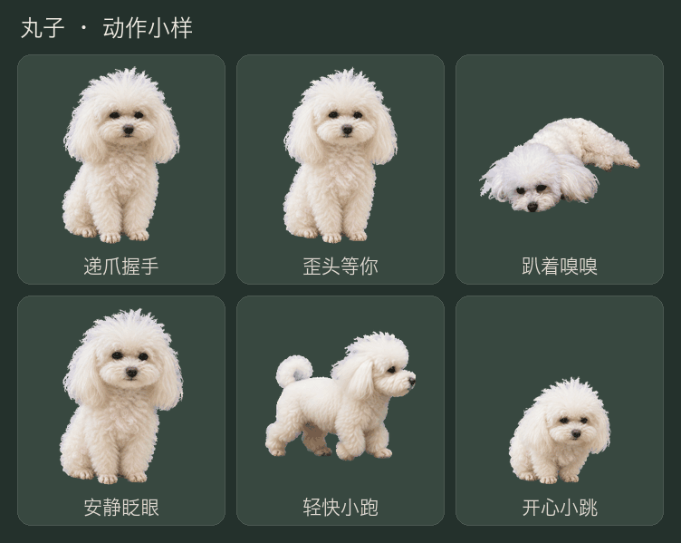

# 丸子 Wanzi

丸子是一隻白色長耳小狗。跟牠打招呼，牠會坐穩，把一隻前爪遞給你。這是依照丸子本尊做的動畫伙伴。

**[在 ChatGPT 領養丸子](https://chatgpt.com/s/sharepet_6b05532bfd488191a343c4b08dbba797)**

用已開放 Pets 功能的 ChatGPT Work 帳號打開連結，點選「領養」即可將丸子加入自己的伙伴收藏。

[下載整套丸子伙伴（ZIP）](https://github.com/goupaishalujiqi/Wanzi-Companion/archive/refs/heads/main.zip)

## 在瀏覽器跟丸子玩

下載並解壓縮整個套件，用瀏覽器開啟 `Wanzi-Playground.html`。頁面可離線使用，收錄十個動作，預設播放遞爪握手。

在動作列表選「丸子拉屎」，牠會先聞地、收腿蹲低，再站起來回頭看。這段會播一次，按「重播」就能再看。其他動作還有歪頭等你、趴著嗅嗅、眨眼、小跑、小跳、伸懶腰、甩耳朵和打哈欠。

## 使用動作圖匯入 ChatGPT Work

在已開放 Pets 功能的 ChatGPT Work 帳號開啟新對話，解壓縮後附上 `wanzi/spritesheet.webp`，再傳送以下訊息。

> 請把附件裡的透明 v2 動作圖建立為我的自訂伙伴，名字是「丸子」。沿用附件的圖案與動畫，建立後把牠設成我的伙伴。

原生伙伴會依工作狀態播放動畫，也能朝 16 個方向看。十個動作都可以在隨附的離線頁面中逐一點播。

## 在提供本機寵物資料夾的 Codex 桌面版安裝

1. 在 Settings → Pets → Custom pets 開啟寵物資料夾。
2. 將套件內整個 `wanzi` 資料夾複製進去，讓 `pet.json` 和 `spritesheet.webp` 並排放在同一層。
3. 回到 Pets 重新整理，選擇「丸子」。

## 套件內容

| 檔案 | 用途 |
| --- | --- |
| `wanzi/spritesheet.webp` | 原生伙伴使用的透明動作圖。每格 192 × 208 px，整圖 1536 × 2288 px |
| `wanzi/pet.json` | 本機桌面版使用的名稱與動作圖設定 |
| `Wanzi-Playground.html` | 十個動作的離線點播頁 |
| `preview/motions.gif`、`preview/potty.gif` | 直接播放的動作預覽 |
| `SHA256SUMS` | 每份檔案的 SHA-256 校驗值 |
